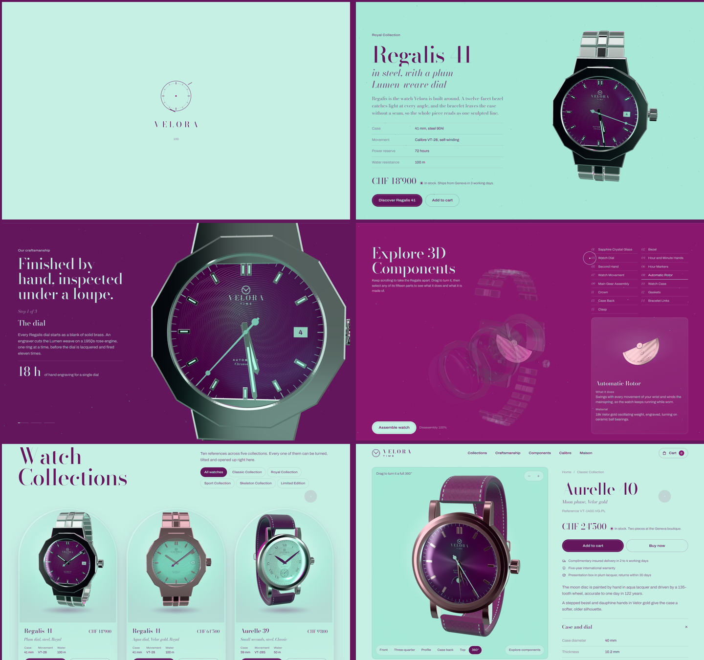

# VELORA TIME

An interactive e-commerce site for **Velora Time**, an original Swiss watch maison. Every watch is a live, procedurally-built 3D model you can turn, tilt, take apart and inspect.



There are no image files or 3D model downloads. The watches, dials, engravings, straps and movements are all generated in code at runtime.

## Run it

```bash
npm install
npm run dev       # http://localhost:5173
npm run build     # static build in dist/
npm run preview   # serve the build
```

The build uses relative paths and hash routing (`#/watch/…`), so `dist/` can be served from any static host or sub-folder (GitHub Pages, Netlify, S3) with no rewrite rules.

## What's on the site

| Route | Content |
| --- | --- |
| `#/` | Hero, featured watch, craftsmanship, exploded 3D components, collections, movement engineering, brand story, limited edition, newsletter, footer |
| `#/watch/:id` | Product detail: large 3D viewer, five viewing angles, zoom, 360° turntable, component explorer, specifications, add to cart, buy now |
| `#/checkout` | Order form with validation and a confirmation screen (no payment is taken; an advisor follows up) |

### The scroll story (home)

One watch, the Regalis 41, is choreographed across the first four sections as you scroll:

1. **Hero**: turns a slow 360° in the centre, set to your local time, while particles drift.
2. **Featured**: slides right and settles at three-quarters beside its specifications.
3. **Craftsmanship** (pinned): the camera moves in for three macro shots: dial, case and crown, bracelet and clasp.
4. **Explore 3D Components** (pinned): the watch separates into its 15 parts, each on a staggered timeline as you scroll. Drag to turn it, click any part (or pick from the list) to highlight it, read its function and material, and see a rotating close-up. **Assemble watch** brings everything back together. If a part is selected, the assembled watch shows it in X-ray.

The page background blends through mint, aqua, plum and magenta as each section arrives.

### The fifteen components

Sapphire crystal, bezel, dial, hour and minute hands, second hand, hour markers, movement (plate, bridges, jewels, balance wheel with breathing hairspring), automatic rotor, gear train, case, crown (and chronograph pushers), gaskets, case back (engraved, with sapphire window), bracelet links or strap, clasp or buckle. The rotor swings, the gears turn and the balance oscillates.

### Collections

Ten references across five collections, each with its own geometry and materials:

- **Classic** (Aurelle): rose-engine guilloché, Roman numerals, small seconds, moon phase, alligator straps
- **Royal** (Regalis): twelve-facet bezel, integrated bracelet, Lumen-weave dial, date
- **Sport** (Tidal): titanium diver with ceramic bezel, flyback chronograph with tachymeter
- **Skeleton** (Lucent): open-worked chapter ring and plate, gear train on show
- **Limited Edition** (Nocturne): plum ceramic flying tourbillon, platinum moon phase

## Design

- **Palette**: mint `#C6F0E4` and aqua `#A7E8D7` for grounds; deep plum `#64165D` and royal magenta `#8A176E` for type, accents, buttons and dark stages. Velor gold, our fictional rose alloy, carries a faint violet note so the metals sit inside the same palette.
- **Type**: Bodoni Moda (display and editorial) with Archivo semi-expanded (interface and specifications), self-hosted via Fontsource.
- **Signature details**: the logo is a dial with two hands at 10:10 forming a V; the hero rings echo the Lumen-weave dial; buttons carry an inner ring like a bezel; product cards are arched vitrines.

## Architecture

```
src/
  three/
    kit.js              geometry helpers: crisp lathe, sweeps, gears, planar UVs
    textures/           canvas-drawn dials, rotor, case back, bezel inserts, straps, studio env
    materials.js        PBR materials (anisotropic sunburst, additive sapphire, ceramic…)
    watch/
      config.js         dimensions, wrist curve, explode offsets, close-up framing
      geometry.js       builders for all 15 components
      Watch.jsx         <WatchModel>: parts, explode timing, highlight + picking registry
    scene/
      Scene3D.jsx       the single shared canvas, studio environment and lights
      WatchViewer.jsx   DOM-tracked view with drag, inertia, tilt, angle presets, picking
      Stage.jsx         the scroll-choreographed home watch and particles
      PartPreview.jsx   close-up view of a single component
  sections/             home sections
  pages/                Home, Product, Checkout, NotFound
  components/           header, cart drawer, preloader, cursor, magnetic button, reveals…
  data/                 catalogue and component descriptions
  lib/                  shared ticker, Lenis smooth scroll, formatting
```

**One canvas, many views.** Every 3D viewport on a page (stage, product cards, close-ups, movement, limited edition) is a drei `View` rendered into a single fixed WebGL canvas with scissoring. That keeps one WebGL context however many watches are on screen, and offscreen views cost nothing.

**One clock.** Lenis, ScrollTrigger and React Three Fiber all run from the GSAP ticker in a fixed order (scroll, then triggers, then render), so the 3D views never lag behind the DOM while scrolling.

**Performance.** Card watches mount only when near the viewport and use 512 px textures; geometry, textures and materials are cached per reference; device pixel ratio is capped at 1.75.

## Stack

React 19, Vite, Three.js, React Three Fiber, drei, GSAP with ScrollTrigger and SplitText, Lenis, Framer Motion, Zustand.

## Accessibility

Keyboard-reachable controls with visible focus, labelled 3D regions, ARIA on tabs, toggles, accordions and dialogs, Escape closes overlays, and `prefers-reduced-motion` turns off smooth scrolling and entrance animation.
